# TBG Ethical & SQA: Role Flow and Status Guide

Last updated: 24/Nov/2026 · Owner: Marco (ICW design)

| What | Link |
| --- | --- |
| Figma file (source of truth) | [TBG Ethical & SQA, page "TBG / Ethical & SQA 2026 (NOW)"](https://www.figma.com/design/HUpqECP1pJFN3GXZcMJgRH/TBG--Ethical---SQA?node-id=7967-2548) |
| Interactive role-flow webview (v9, 24/Nov/2026) | [claude.ai/artifact/Eh4B3nJSS5tiF2KWsC2VEs](https://claude.ai/artifact/Eh4B3nJSS5tiF2KWsC2VEs). Clickable prototype by role, supplier status column, role lanes by stage, audit-type filter, 26-status register. |
| GitHub (public) | Repo [marconip2026/tbg-ethical-flow](https://github.com/marconip2026/tbg-ethical-flow) · live page [marconip2026.github.io/tbg-ethical-flow](https://marconip2026.github.io/tbg-ethical-flow/). Same webview as the artifact; pushed after each update. |
| Clickable Figma prototype (end-to-end) | [Play in Figma](https://www.figma.com/proto/HUpqECP1pJFN3GXZcMJgRH/TBG--Ethical---SQA?page-id=7967%3A2548&node-id=7965-6492&starting-point-node-id=7965%3A6492&scaling=scale-down-width&content-scaling=fixed). All 32 flows are listed under "Clickable prototype, by role". |
| Screenshots | `img/` next to this file (00–20) |

---

## Brief for building the public website

Use this file as the only content source for a one-page website that explains the TBG Ethical flow.

1. **Hero.** Title, a one-line purpose, and links to Figma and the webview.
2. **Clickable prototype, by role.** One big end-to-end ▶ card, then one card per role listing its flows from "Clickable prototype, by role". Every ▶ link opens the Figma prototype in a new tab. Also put the matching ▶ links at the top of each stage.
3. **Roles.** One card per role, using the "Roles" table.
4. **Audit paths A–D.** A small legend.
5. **Flow by stage.** Nine stages, left to right. In each stage, show what each role does, which screens it uses, and the status after the step. Lay it out as role rows × stage columns (swim lanes).
6. **Status list.** One table, in order, grouped by stage, with a coloured dot per tone:

   | Tone | Colour |
   | --- | --- |
   | Neutral | grey |
   | Info | blue |
   | Warning | amber |
   | Error | red |
   | Success | green |

7. **Hand-off rules.** Reasons, the return loop, save draft and destructive actions.
8. **Screen index.** Every screen, with its Figma link.
9. **Gallery.** The `img/` screenshots with their captions.

Styling: WBA design system. Primary blue `#003DA5`, Roboto, 2px radius on controls and 4px on cards, fully ruled tables, no emoji, buttons in UPPERCASE.

---

## Clickable prototype, by role

Each link opens the Figma prototype at the start of that flow. The flows are also set as flow starting points on the Figma page, so they show in the prototype viewer's flow list. The top-bar role switch on every screen goes to that role's home page.

| Role | Flow | Prototype |
| --- | --- | --- |
| End-to-end | **▶ E2E** · Login → apply → review → kick start → audit → conclusion | [▶ Play](https://www.figma.com/proto/HUpqECP1pJFN3GXZcMJgRH/TBG--Ethical---SQA?page-id=7967%3A2548&node-id=7965-6492&starting-point-node-id=7965%3A6492&scaling=scale-down-width&content-scaling=fixed) |
| Buyer | **Buyer 1** · Send the application e-mail to a new supplier | [▶ Play](https://www.figma.com/proto/HUpqECP1pJFN3GXZcMJgRH/TBG--Ethical---SQA?page-id=7967%3A2548&node-id=7965-6557&starting-point-node-id=7965%3A6557&scaling=scale-down-width&content-scaling=fixed) |
| Supplier | **Supplier 1** · Factory list → start ethical application | [▶ Play](https://www.figma.com/proto/HUpqECP1pJFN3GXZcMJgRH/TBG--Ethical---SQA?page-id=7967%3A2548&node-id=7965-6602&starting-point-node-id=7965%3A6602&scaling=scale-down-width&content-scaling=fixed) |
| Supplier | **Supplier 2** · Factory list · map view | [▶ Play](https://www.figma.com/proto/HUpqECP1pJFN3GXZcMJgRH/TBG--Ethical---SQA?page-id=7967%3A2548&node-id=8205-9607&starting-point-node-id=8205%3A9607&scaling=scale-down-width&content-scaling=fixed) |
| Supplier | **Supplier 3** · Fill registered & subcontracting factories → save draft / submit | [▶ Play](https://www.figma.com/proto/HUpqECP1pJFN3GXZcMJgRH/TBG--Ethical---SQA?page-id=7967%3A2548&node-id=8306-13092&starting-point-node-id=8306%3A13092&scaling=scale-down-width&content-scaling=fixed) |
| Supplier | **Supplier 4** · Application returned → edit → resubmit | [▶ Play](https://www.figma.com/proto/HUpqECP1pJFN3GXZcMJgRH/TBG--Ethical---SQA?page-id=7967%3A2548&node-id=8382-13945&starting-point-node-id=8382%3A13945&scaling=scale-down-width&content-scaling=fixed) |
| Supplier | **Supplier 5** · Application rejected | [▶ Play](https://www.figma.com/proto/HUpqECP1pJFN3GXZcMJgRH/TBG--Ethical---SQA?page-id=7967%3A2548&node-id=8382-15406&starting-point-node-id=8382%3A15406&scaling=scale-down-width&content-scaling=fixed) |
| Supplier | **Supplier 6** · Application accepted | [▶ Play](https://www.figma.com/proto/HUpqECP1pJFN3GXZcMJgRH/TBG--Ethical---SQA?page-id=7967%3A2548&node-id=8382-15701&starting-point-node-id=8382%3A15701&scaling=scale-down-width&content-scaling=fixed) |
| Supplier | **Supplier 7** · Accept or reject the quotation | [▶ Play](https://www.figma.com/proto/HUpqECP1pJFN3GXZcMJgRH/TBG--Ethical---SQA?page-id=7967%3A2548&node-id=8068-6965&starting-point-node-id=8068%3A6965&scaling=scale-down-width&content-scaling=fixed) |
| Supplier | **Supplier 8** · Invoice unpaid → pay | [▶ Play](https://www.figma.com/proto/HUpqECP1pJFN3GXZcMJgRH/TBG--Ethical---SQA?page-id=7967%3A2548&node-id=8264-11826&starting-point-node-id=8264%3A11826&scaling=scale-down-width&content-scaling=fixed) |
| Supplier | **Supplier 9** · Upload documents / existing report | [▶ Play](https://www.figma.com/proto/HUpqECP1pJFN3GXZcMJgRH/TBG--Ethical---SQA?page-id=7967%3A2548&node-id=8343-13944&starting-point-node-id=8343%3A13944&scaling=scale-down-width&content-scaling=fixed) |
| Supplier | **Supplier 10** · Submit CAP | [▶ Play](https://www.figma.com/proto/HUpqECP1pJFN3GXZcMJgRH/TBG--Ethical---SQA?page-id=7967%3A2548&node-id=8172-9777&starting-point-node-id=8172%3A9777&scaling=scale-down-width&content-scaling=fixed) |
| Ethical team | **Ethical 1** · Home dashboard | [▶ Play](https://www.figma.com/proto/HUpqECP1pJFN3GXZcMJgRH/TBG--Ethical---SQA?page-id=7967%3A2548&node-id=8331-13854&starting-point-node-id=8331%3A13854&scaling=scale-down-width&content-scaling=fixed) |
| Ethical team | **Ethical 2** · Supplier list (factories expanded) | [▶ Play](https://www.figma.com/proto/HUpqECP1pJFN3GXZcMJgRH/TBG--Ethical---SQA?page-id=7967%3A2548&node-id=8329-13639&starting-point-node-id=8329%3A13639&scaling=scale-down-width&content-scaling=fixed) |
| Ethical team | **Ethical 3** · Supplier list · map view | [▶ Play](https://www.figma.com/proto/HUpqECP1pJFN3GXZcMJgRH/TBG--Ethical---SQA?page-id=7967%3A2548&node-id=8352-13597&starting-point-node-id=8352%3A13597&scaling=scale-down-width&content-scaling=fixed) |
| Ethical team | **Ethical 4** · Open task → view application (read only) | [▶ Play](https://www.figma.com/proto/HUpqECP1pJFN3GXZcMJgRH/TBG--Ethical---SQA?page-id=7967%3A2548&node-id=8334-14734&starting-point-node-id=8334%3A14734&scaling=scale-down-width&content-scaling=fixed) |
| Ethical team | **Ethical 5** · Review application → accept / return / reject | [▶ Play](https://www.figma.com/proto/HUpqECP1pJFN3GXZcMJgRH/TBG--Ethical---SQA?page-id=7967%3A2548&node-id=7967-6258&starting-point-node-id=7967%3A6258&scaling=scale-down-width&content-scaling=fixed) |
| Ethical team | **Ethical 6** · Review resubmitted application | [▶ Play](https://www.figma.com/proto/HUpqECP1pJFN3GXZcMJgRH/TBG--Ethical---SQA?page-id=7967%3A2548&node-id=8374-13858&starting-point-node-id=8374%3A13858&scaling=scale-down-width&content-scaling=fixed) |
| Ethical team | **Ethical 7** · Kick start → audit type and lab | [▶ Play](https://www.figma.com/proto/HUpqECP1pJFN3GXZcMJgRH/TBG--Ethical---SQA?page-id=7967%3A2548&node-id=7984-2572&starting-point-node-id=7984%3A2572&scaling=scale-down-width&content-scaling=fixed) |
| Ethical team | **Ethical 8** · Review lab quote → markup → release | [▶ Play](https://www.figma.com/proto/HUpqECP1pJFN3GXZcMJgRH/TBG--Ethical---SQA?page-id=7967%3A2548&node-id=8169-10112&starting-point-node-id=8169%3A10112&scaling=scale-down-width&content-scaling=fixed) |
| Ethical team | **Ethical 9** · Desktop review in house | [▶ Play](https://www.figma.com/proto/HUpqECP1pJFN3GXZcMJgRH/TBG--Ethical---SQA?page-id=7967%3A2548&node-id=8343-14858&starting-point-node-id=8343%3A14858&scaling=scale-down-width&content-scaling=fixed) |
| Ethical team | **Ethical 10** · Review report → accept / revise / CAP | [▶ Play](https://www.figma.com/proto/HUpqECP1pJFN3GXZcMJgRH/TBG--Ethical---SQA?page-id=7967%3A2548&node-id=8343-14555&starting-point-node-id=8343%3A14555&scaling=scale-down-width&content-scaling=fixed) |
| Ethical team | **Ethical 11** · Review existing report | [▶ Play](https://www.figma.com/proto/HUpqECP1pJFN3GXZcMJgRH/TBG--Ethical---SQA?page-id=7967%3A2548&node-id=8259-11423&starting-point-node-id=8259%3A11423&scaling=scale-down-width&content-scaling=fixed) |
| Ethical team | **Ethical 12** · Review CAP | [▶ Play](https://www.figma.com/proto/HUpqECP1pJFN3GXZcMJgRH/TBG--Ethical---SQA?page-id=7967%3A2548&node-id=8172-10030&starting-point-node-id=8172%3A10030&scaling=scale-down-width&content-scaling=fixed) |
| Ethical team | **Ethical 13** · Conclusion → approve / temporary / reject | [▶ Play](https://www.figma.com/proto/HUpqECP1pJFN3GXZcMJgRH/TBG--Ethical---SQA?page-id=7967%3A2548&node-id=8256-10993&starting-point-node-id=8256%3A10993&scaling=scale-down-width&content-scaling=fixed) |
| Lab | **Lab 1** · Audit list (SVSI + Ethical Audit) | [▶ Play](https://www.figma.com/proto/HUpqECP1pJFN3GXZcMJgRH/TBG--Ethical---SQA?page-id=7967%3A2548&node-id=8368-14084&starting-point-node-id=8368%3A14084&scaling=scale-down-width&content-scaling=fixed) |
| Lab | **Lab 2** · Submit quotation | [▶ Play](https://www.figma.com/proto/HUpqECP1pJFN3GXZcMJgRH/TBG--Ethical---SQA?page-id=7967%3A2548&node-id=8343-12423&starting-point-node-id=8343%3A12423&scaling=scale-down-width&content-scaling=fixed) |
| Lab | **Lab 3** · Onsite audit | [▶ Play](https://www.figma.com/proto/HUpqECP1pJFN3GXZcMJgRH/TBG--Ethical---SQA?page-id=7967%3A2548&node-id=8343-12787&starting-point-node-id=8343%3A12787&scaling=scale-down-width&content-scaling=fixed) |
| Lab | **Lab 4** · Desktop review | [▶ Play](https://www.figma.com/proto/HUpqECP1pJFN3GXZcMJgRH/TBG--Ethical---SQA?page-id=7967%3A2548&node-id=8343-13370&starting-point-node-id=8343%3A13370&scaling=scale-down-width&content-scaling=fixed) |
| Lab | **Lab 5** · Upload report | [▶ Play](https://www.figma.com/proto/HUpqECP1pJFN3GXZcMJgRH/TBG--Ethical---SQA?page-id=7967%3A2548&node-id=8343-13077&starting-point-node-id=8343%3A13077&scaling=scale-down-width&content-scaling=fixed) |
| Lab | **Lab 6** · Upload revised report | [▶ Play](https://www.figma.com/proto/HUpqECP1pJFN3GXZcMJgRH/TBG--Ethical---SQA?page-id=7967%3A2548&node-id=8343-13663&starting-point-node-id=8343%3A13663&scaling=scale-down-width&content-scaling=fixed) |
| ICW account | **ICW 1** · Invoice draft → issued → paid | [▶ Play](https://www.figma.com/proto/HUpqECP1pJFN3GXZcMJgRH/TBG--Ethical---SQA?page-id=7967%3A2548&node-id=8264-11556&starting-point-node-id=8264%3A11556&scaling=scale-down-width&content-scaling=fixed) |

---

## Roles

| Role | Who | What they do | Where they start |
| --- | --- | --- | --- |
| **Buyer** | WBA / Boots buyer | Sends the application e-mail to a new supplier, and later sees the result | [1a.01 Login](https://www.figma.com/design/HUpqECP1pJFN3GXZcMJgRH/TBG--Ethical---SQA?node-id=7965-6492) |
| **Supplier** | Supplier user, its registered factory and its subcontracting factories | Fills in, saves and submits the application; reads return / reject reasons; edits and resubmits; accepts the quotation; pays the invoice; uploads documents; submits the CAP | [1b.01 Factory List](https://www.figma.com/design/HUpqECP1pJFN3GXZcMJgRH/TBG--Ethical---SQA?node-id=7965-6602) → Factory → Tasks → Ethical |
| **Ethical team (TBG)** | TBG ethical team, including the ethical manager | Reviews the application (accept, return or reject, with a reason); kicks start the audit; enters the quote markup; reviews the report and CAP; gives the conclusion | [E.00 Ethical Home](https://www.figma.com/design/HUpqECP1pJFN3GXZcMJgRH/TBG--Ethical---SQA?node-id=8331-13854) |
| **Lab** | UL, TÜV SÜD and other labs | Quotes, runs the audit or desktop review, uploads and revises the report | [L.00 Audit List](https://www.figma.com/design/HUpqECP1pJFN3GXZcMJgRH/TBG--Ethical---SQA?node-id=8368-14084) (SVSI + Ethical Audit) |
| **ICW account** | Account system | Issues the invoice and confirms payment | — |

The role switch at the top right of every screen (BUYER SEND · SUPPLIER · ETHICAL · LAB) jumps between the role start pages.

**What each role can see.** The lab sees nothing until the application is accepted and a quotation is requested. While an application is under review, returned or rejected, only the supplier and the ethical team are involved.

## Audit paths

| Path | Meaning | Quotation and invoice? |
| --- | --- | --- |
| **A** | Onsite factory audit by a lab | Yes |
| **B** | Desktop review by a lab | Yes |
| **C** | Desktop review in house by TBG | No |
| **D** | Existing report reviewed by TBG | No |

---

## Overview

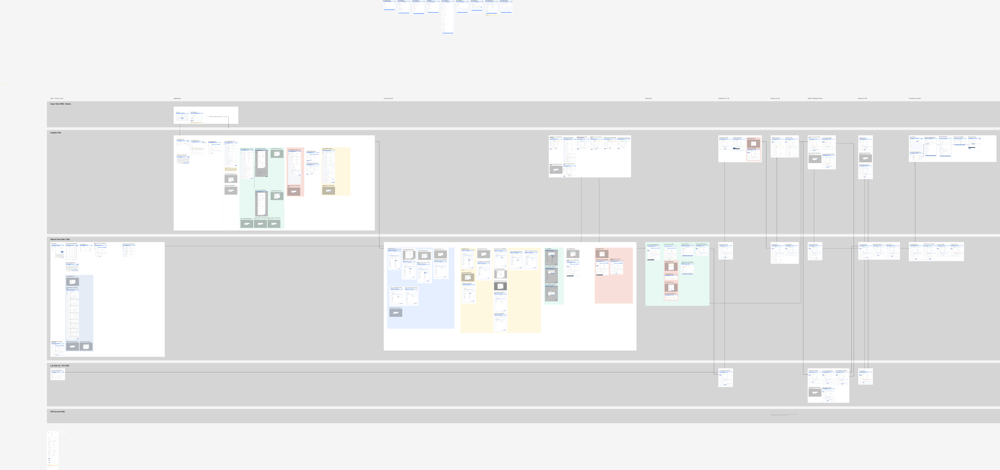

The page has 9 stage columns:

1. Start · Home & Lists
2. Application
3. Factory Check
4. Kick Start
5. Quotation (A / B)
6. Invoice (A / B)
7. Audit / Desktop Review
8. Report & CAP
9. Conclusion & After

Lanes from top to bottom: Buyer, Supplier, Ethical team, Lab, ICW account.

---

## Flow by stage

### 1 · Start: Home and lists

- **Ethical team: [E.00 Home](https://www.figma.com/design/HUpqECP1pJFN3GXZcMJgRH/TBG--Ethical---SQA?node-id=8331-13854).** KPI tiles, Ethical Audit card, Application & Kick Start card, dashboard and factory map. Clicking a number opens the [E.02 Supplier List](https://www.figma.com/design/HUpqECP1pJFN3GXZcMJgRH/TBG--Ethical---SQA?node-id=8332-14406).
- **Ethical team: [E.01 Supplier List](https://www.figma.com/design/HUpqECP1pJFN3GXZcMJgRH/TBG--Ethical---SQA?node-id=8329-13639).** The SVSI Supplier List with factories expanded and an Ethical Task Status column. The [map view (E.01m)](https://www.figma.com/design/HUpqECP1pJFN3GXZcMJgRH/TBG--Ethical---SQA?node-id=8352-13597) colours each pin by status; hovering a pin shows a tooltip ([E.01mh](https://www.figma.com/design/HUpqECP1pJFN3GXZcMJgRH/TBG--Ethical---SQA?node-id=8440-17152)) and clicking it opens the task.
- **Ethical team: form templates.** [3.01a Form Templates](https://www.figma.com/design/HUpqECP1pJFN3GXZcMJgRH/TBG--Ethical---SQA?node-id=8033-8408) and the [2.00e form builder](https://www.figma.com/design/HUpqECP1pJFN3GXZcMJgRH/TBG--Ethical---SQA?node-id=8233-9714).
- **Lab: [L.00 Audit List](https://www.figma.com/design/HUpqECP1pJFN3GXZcMJgRH/TBG--Ethical---SQA?node-id=8368-14084).** Laid out like the SVSI list, with Ethical Audit added.

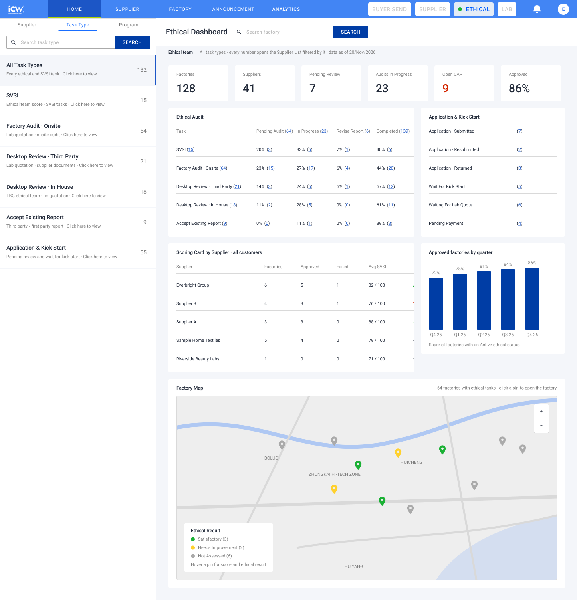
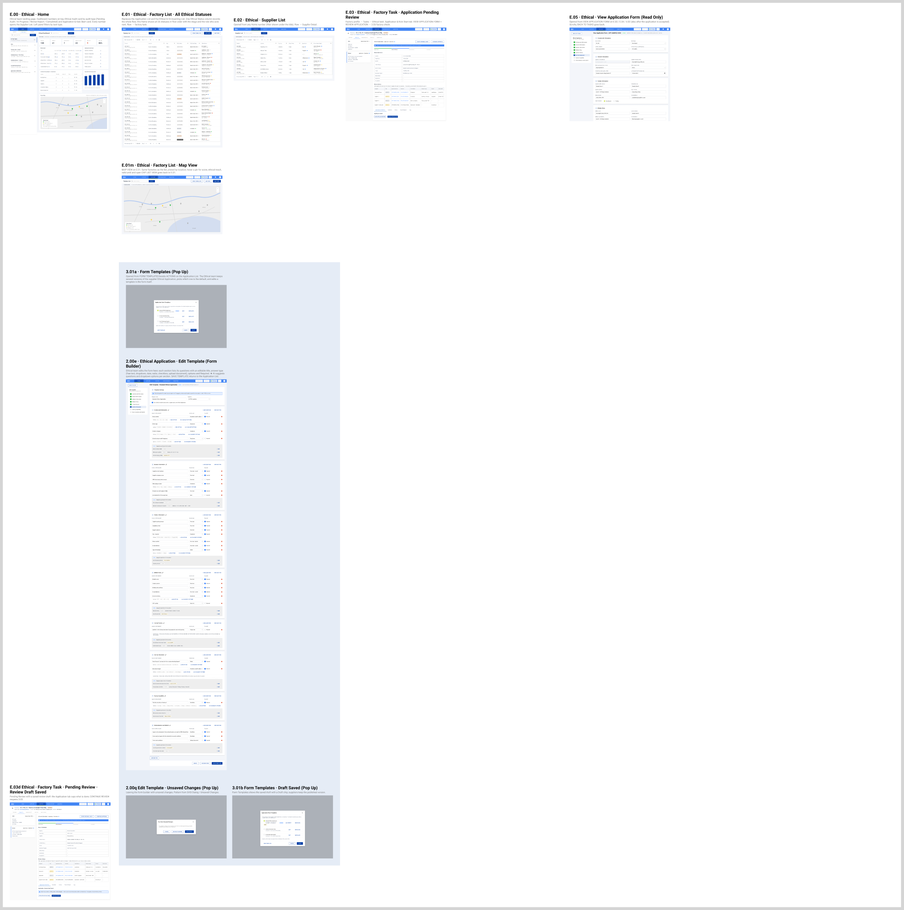
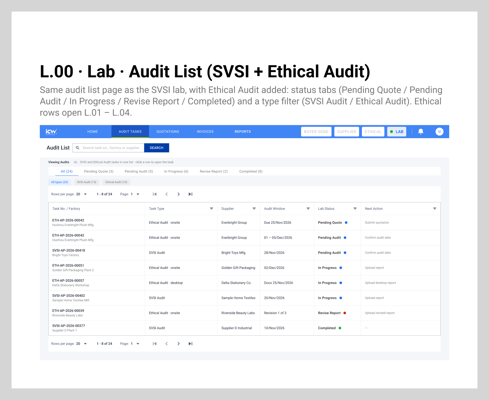

### 2 · Application

- **Buyer** sends the application e-mail to a new supplier: [1a.02](https://www.figma.com/design/HUpqECP1pJFN3GXZcMJgRH/TBG--Ethical---SQA?node-id=7965-6557).
- **Supplier: [1b.03](https://www.figma.com/design/HUpqECP1pJFN3GXZcMJgRH/TBG--Ethical---SQA?node-id=8286-17303).** Starts an ethical application from the factory profile.
- **Supplier: [1b.04](https://www.figma.com/design/HUpqECP1pJFN3GXZcMJgRH/TBG--Ethical---SQA?node-id=8306-13092).** Fills in registered factory and subcontracting factory details. The form opens in its empty default state; the [front-end note](https://www.figma.com/design/HUpqECP1pJFN3GXZcMJgRH/TBG--Ethical---SQA?node-id=8360-13640) explains the jumping sections.
- **Supplier submits.** [1b.06](https://www.figma.com/design/HUpqECP1pJFN3GXZcMJgRH/TBG--Ethical---SQA?node-id=7979-2918) shows Pending Review.
- **Save draft.** [1b.06d](https://www.figma.com/design/HUpqECP1pJFN3GXZcMJgRH/TBG--Ethical---SQA?node-id=8389-18812): the task status is Draft, and the Application tab shows Last Saved and Progress.

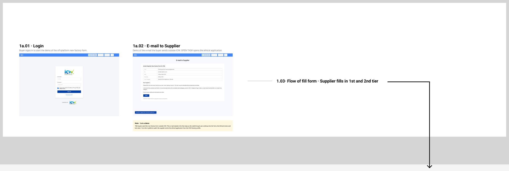
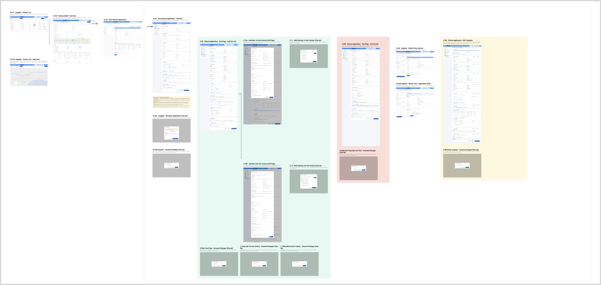

### 3 · Factory check: accept, return or reject

- **Ethical team: [E.03 Pending Review](https://www.figma.com/design/HUpqECP1pJFN3GXZcMJgRH/TBG--Ethical---SQA?node-id=8334-14734)** → [3.03 Factory Review](https://www.figma.com/design/HUpqECP1pJFN3GXZcMJgRH/TBG--Ethical---SQA?node-id=7967-6258). The review checks the registered and subcontracting factories against the factory database and shows the Review History.
- **Accept:** [3.05](https://www.figma.com/design/HUpqECP1pJFN3GXZcMJgRH/TBG--Ethical---SQA?node-id=7967-6624) → [4.02a Accepted](https://www.figma.com/design/HUpqECP1pJFN3GXZcMJgRH/TBG--Ethical---SQA?node-id=8366-17971). The factory header gets an "Accepted Lab" chip. The supplier sees [1b.08a](https://www.figma.com/design/HUpqECP1pJFN3GXZcMJgRH/TBG--Ethical---SQA?node-id=8382-15701).
- **Return:** [3.03t](https://www.figma.com/design/HUpqECP1pJFN3GXZcMJgRH/TBG--Ethical---SQA?node-id=8366-18681) has a **required Return Reason** → [E.04 Waiting For Supplier Resubmit](https://www.figma.com/design/HUpqECP1pJFN3GXZcMJgRH/TBG--Ethical---SQA?node-id=8371-18403). On the supplier side:
  1. [1b.08 Returned](https://www.figma.com/design/HUpqECP1pJFN3GXZcMJgRH/TBG--Ethical---SQA?node-id=8382-13945) shows the reason.
  2. [1b.08e Edit](https://www.figma.com/design/HUpqECP1pJFN3GXZcMJgRH/TBG--Ethical---SQA?node-id=8382-14247) keeps the answers and marks the flagged section.
  3. [1b.04r Resubmit](https://www.figma.com/design/HUpqECP1pJFN3GXZcMJgRH/TBG--Ethical---SQA?node-id=8374-14227) has a **required Resubmit Reason**.
  4. [1b.08b Resubmitted](https://www.figma.com/design/HUpqECP1pJFN3GXZcMJgRH/TBG--Ethical---SQA?node-id=8382-14820) is read only.
  5. The ethical team sees [E.03b Resubmitted](https://www.figma.com/design/HUpqECP1pJFN3GXZcMJgRH/TBG--Ethical---SQA?node-id=8374-13858), which shows both reasons.
  6. The loop can repeat: [1b.08c Returned again (round 2)](https://www.figma.com/design/HUpqECP1pJFN3GXZcMJgRH/TBG--Ethical---SQA?node-id=8382-15107).
- **Reject:** [3.03r](https://www.figma.com/design/HUpqECP1pJFN3GXZcMJgRH/TBG--Ethical---SQA?node-id=8179-9615) has a **required Reject Reason** → [E.06 Application Rejected](https://www.figma.com/design/HUpqECP1pJFN3GXZcMJgRH/TBG--Ethical---SQA?node-id=8366-18181). The supplier sees [1b.08r](https://www.figma.com/design/HUpqECP1pJFN3GXZcMJgRH/TBG--Ethical---SQA?node-id=8382-15406), with the application closed and START NEW APPLICATION.
- **Decision options on every factory.** On registered and subcontracting factory review pages the decision box always offers the other paths:

  | State | Buttons |
  | --- | --- |
  | AI match found (3.03, 3.04, 3.04z, 3.04-sel, 3.05) | CONFIRM THIS FACTORY · MARK AS NEW · CREATE NEW |
  | Marked as new (3.03n1, 3.04b2) | SELECT EXISTING · CREATE NEW · CONFIRM |
  | Created new (3.03e) | MARK AS NEW · CREATE NEW · CONFIRM THIS FACTORY |
  | Confirmed as new (3.03c, 3.03n2, 3.04e, 3.04e2, 3.04f) | UNDO · SELECT EXISTING · CREATE NEW |
  | Confirmed existing (3.04g) | UNDO · MARK AS NEW · CREATE NEW |

  The factory chip always reads Subcontracting Factory.
- **Registered and subcontracting factory (no tiers).** Sarah asked to drop the tier wording. 1st tier → **Registered Factory**, 2nd tier → **Subcontracting Factory** on every screen, pop-up, tab, chip, button and frame name (e.g. ADD SUBCONTRACTING FACTORY, tabs "Registered · Factory C" / "Subcontracting · …"). The Type column in Review History shows Registered / Subcontracting. Codes stay the same (F-code for registered, T-code for subcontracting). Impact: wording only, every role sees the new names; no flow or data change.
- **Switch warning after confirm.** When a factory is confirmed as new, SELECT EXISTING, CREATE NEW and MARK AS NEW first open **Switch Factory Choice?**. It warns that the Mark as New / Create New details and the temporary code are cleared and cannot be restored. CANCEL keeps the choice; SWITCH TO … opens the chosen pop-up. A confirmed existing factory (3.04g) switches without the warning.

  | Factory | Select Existing | Create New | Mark as New |
  | --- | --- | --- | --- |
  | Registered | [3.03w1](https://www.figma.com/design/HUpqECP1pJFN3GXZcMJgRH/TBG--Ethical---SQA?node-id=8447-17702) | [3.03w2](https://www.figma.com/design/HUpqECP1pJFN3GXZcMJgRH/TBG--Ethical---SQA?node-id=8447-17737) | [3.03w3](https://www.figma.com/design/HUpqECP1pJFN3GXZcMJgRH/TBG--Ethical---SQA?node-id=8447-17772) |
  | Subcontracting | [3.04w1](https://www.figma.com/design/HUpqECP1pJFN3GXZcMJgRH/TBG--Ethical---SQA?node-id=8447-17808) | [3.04w2](https://www.figma.com/design/HUpqECP1pJFN3GXZcMJgRH/TBG--Ethical---SQA?node-id=8447-17843) | [3.04w3](https://www.figma.com/design/HUpqECP1pJFN3GXZcMJgRH/TBG--Ethical---SQA?node-id=8447-17878) |

  Only the ethical team is affected. The supplier, lab and ICW admin see nothing, because the factory code is created only when the application is accepted.
- **Decision box layout.** The confirmed bar reads *Confirmed - code* (for example Confirmed - F-TEMP-0042), fills the box width and keeps UNDO on the right. Box titles are in title case (Confirmed as New Factory) and centred with their chip. On match cards the match chip sits under the factory name, so long names wrap.
- **Read-only form:** [E.05](https://www.figma.com/design/HUpqECP1pJFN3GXZcMJgRH/TBG--Ethical---SQA?node-id=8334-14143).

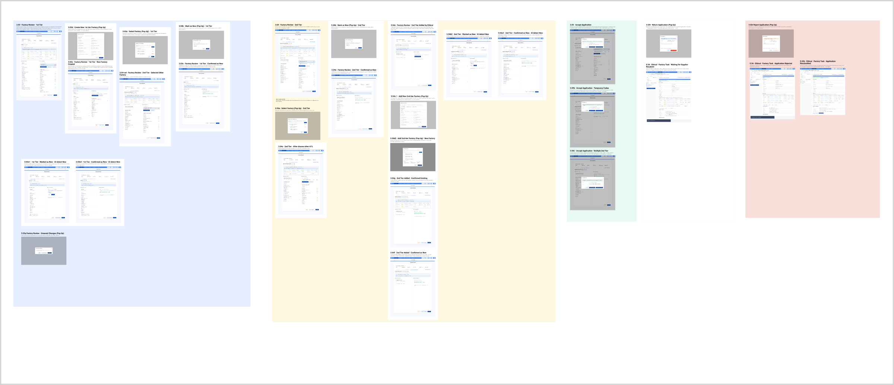
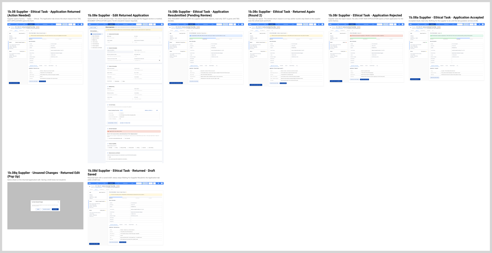

### 4 · Kick start

- **Ethical team: [4.02 Kick Start](https://www.figma.com/design/HUpqECP1pJFN3GXZcMJgRH/TBG--Ethical---SQA?node-id=7984-2572).** Sets the audit type (A–D), the deadline, who does each step, and the lab.
- **Path D:** the existing report goes to [4.03b](https://www.figma.com/design/HUpqECP1pJFN3GXZcMJgRH/TBG--Ethical---SQA?node-id=8259-11423).

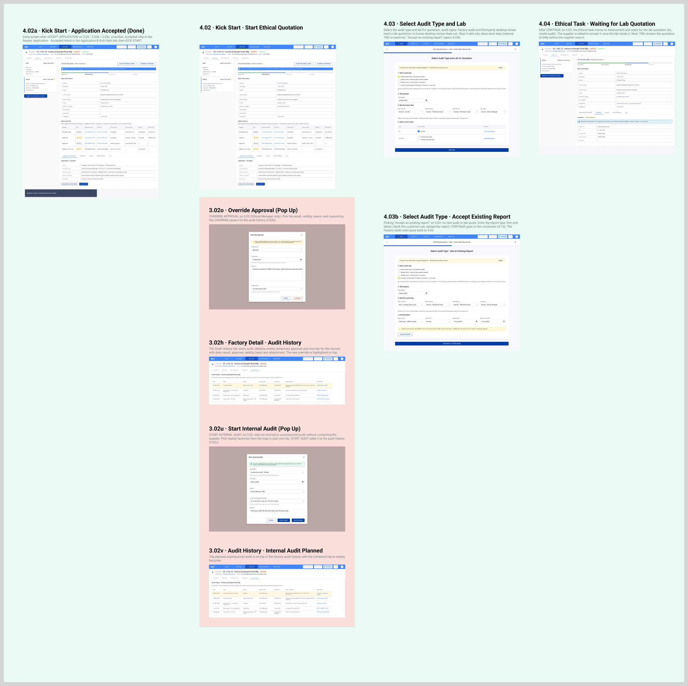

### 5 · Quotation (paths A and B)

1. **Lab: [L.01](https://www.figma.com/design/HUpqECP1pJFN3GXZcMJgRH/TBG--Ethical---SQA?node-id=8343-12423).** Submits the quotation.
2. **Ethical team: [4.04b](https://www.figma.com/design/HUpqECP1pJFN3GXZcMJgRH/TBG--Ethical---SQA?node-id=8169-10112).** Types the markup by hand, then releases the quote to the supplier.
3. **Supplier:** [4.05 Accept](https://www.figma.com/design/HUpqECP1pJFN3GXZcMJgRH/TBG--Ethical---SQA?node-id=8068-6965) or [4.05x Reject](https://www.figma.com/design/HUpqECP1pJFN3GXZcMJgRH/TBG--Ethical---SQA?node-id=8255-10875).

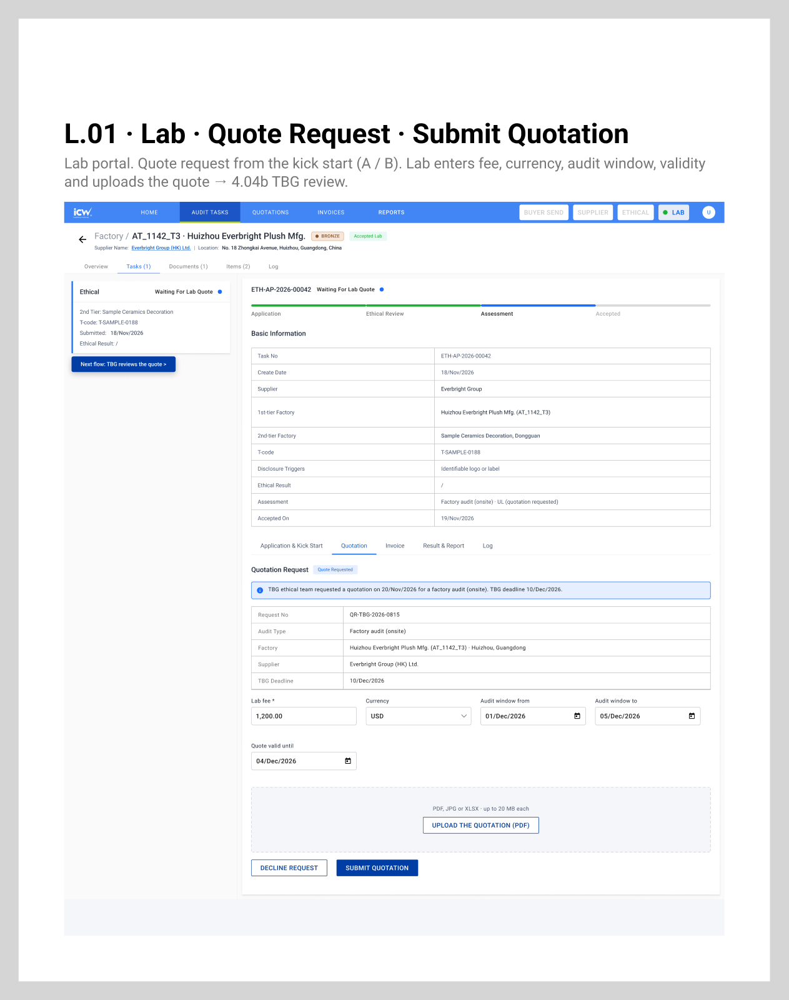
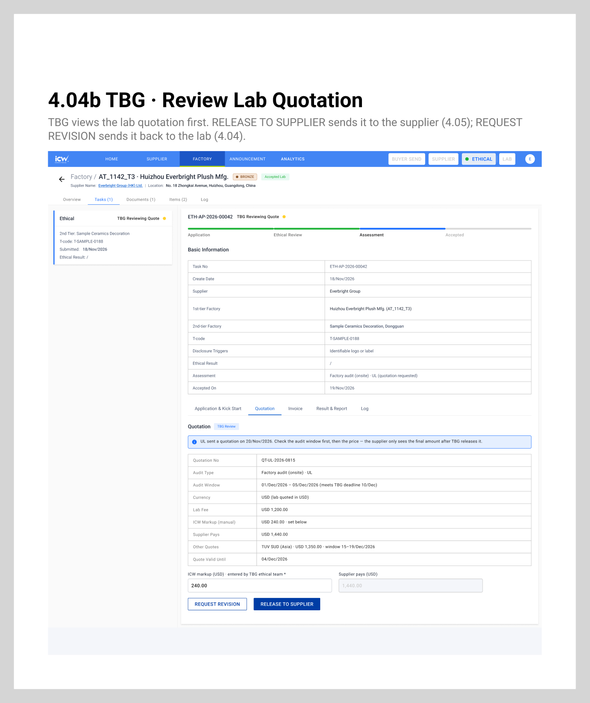
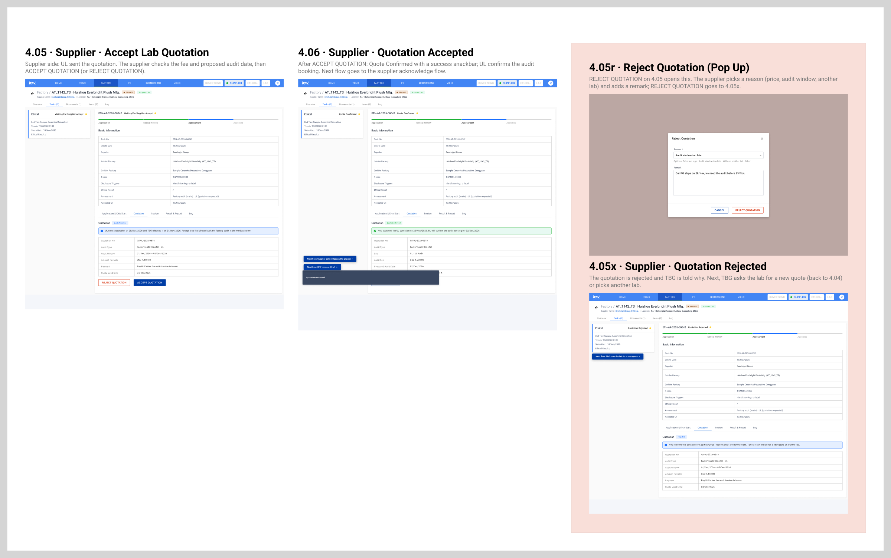

### 6 · Invoice (paths A and B)

The Invoice tab follows the SVSI layout:

1. Header: invoice no., payment status and task status, with the amount and date on the right.
2. **Inspection Plan** table: Item / Mandays / Cost / Sub-Total, then VAT and Total.
3. **Other Details**.
4. **Last Updated**.
5. **Payer Details**.

| Payment status | Task status | Screen |
| --- | --- | --- |
| Draft | Pending Invoice | [4.12 TBG · Invoice Draft](https://www.figma.com/design/HUpqECP1pJFN3GXZcMJgRH/TBG--Ethical---SQA?node-id=8264-11556) |
| Unpaid | Pending Payment | [4.13 Supplier · Invoice Unpaid](https://www.figma.com/design/HUpqECP1pJFN3GXZcMJgRH/TBG--Ethical---SQA?node-id=8264-11826) |
| Paid | Pending Audit | [4.14 Supplier · Invoice Paid](https://www.figma.com/design/HUpqECP1pJFN3GXZcMJgRH/TBG--Ethical---SQA?node-id=8264-12092) → [4.15 TBG · Pending Audit](https://www.figma.com/design/HUpqECP1pJFN3GXZcMJgRH/TBG--Ethical---SQA?node-id=8264-12347) |

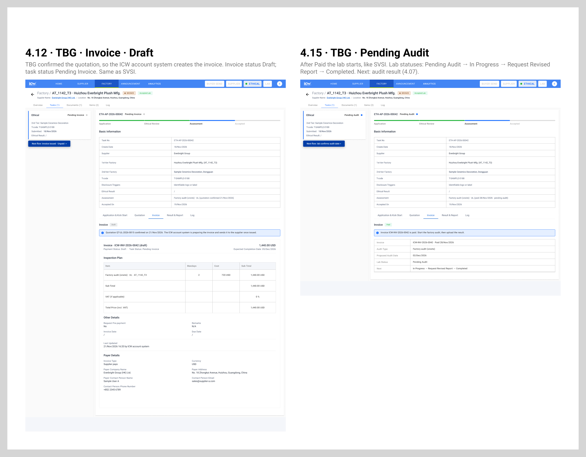
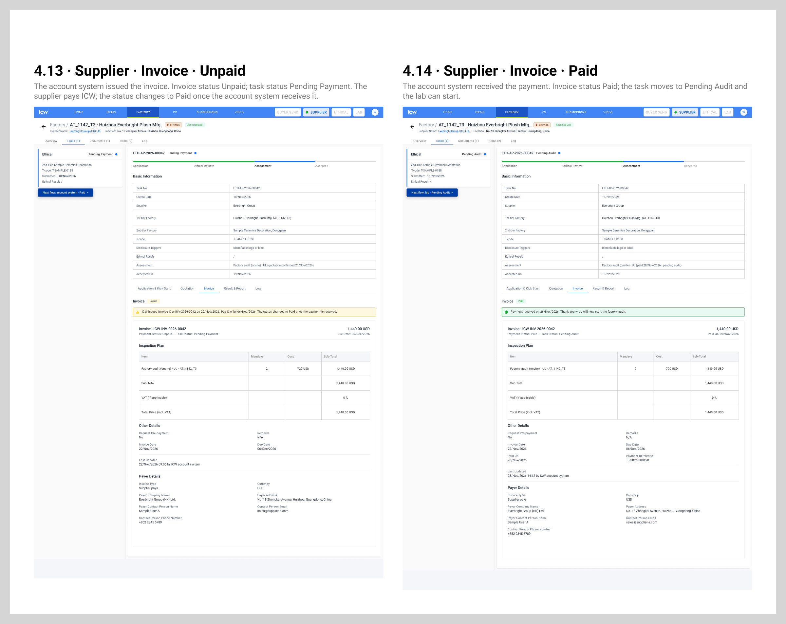

### 7 · Audit or desktop review

- **Lab (path A):** [L.02 Pending Audit](https://www.figma.com/design/HUpqECP1pJFN3GXZcMJgRH/TBG--Ethical---SQA?node-id=8343-12787) → [L.03 Audit In Progress · Upload Report](https://www.figma.com/design/HUpqECP1pJFN3GXZcMJgRH/TBG--Ethical---SQA?node-id=8343-13077).
- **Lab (path B):** desktop review in [L.03b](https://www.figma.com/design/HUpqECP1pJFN3GXZcMJgRH/TBG--Ethical---SQA?node-id=8343-13370).
- **Supplier (paths B, C, D):** uploads documents in [S.01](https://www.figma.com/design/HUpqECP1pJFN3GXZcMJgRH/TBG--Ethical---SQA?node-id=8343-13944) → [S.02 Submitted](https://www.figma.com/design/HUpqECP1pJFN3GXZcMJgRH/TBG--Ethical---SQA?node-id=8343-14270).
- **Ethical team (path C):** desktop review in house in [T.02](https://www.figma.com/design/HUpqECP1pJFN3GXZcMJgRH/TBG--Ethical---SQA?node-id=8343-14858).

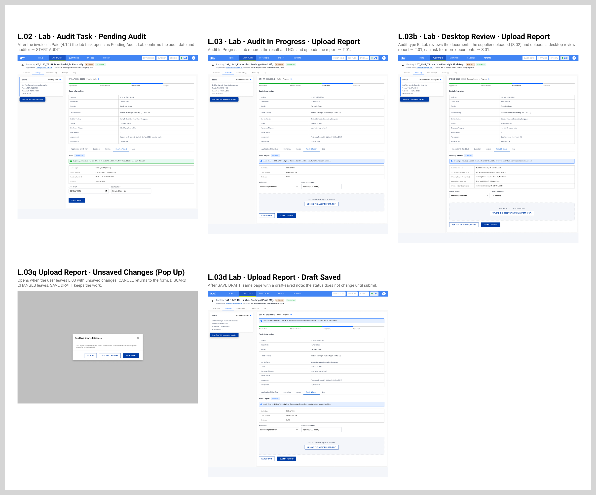
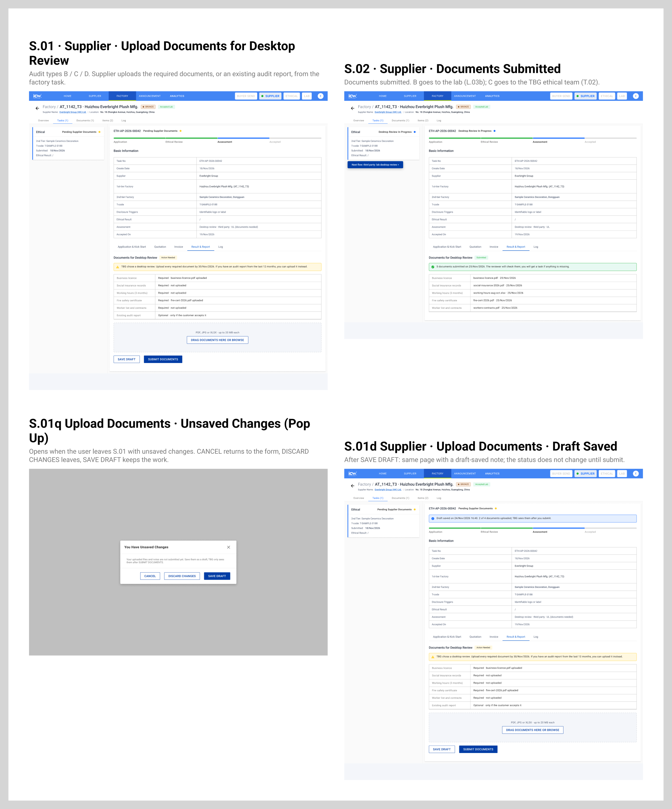
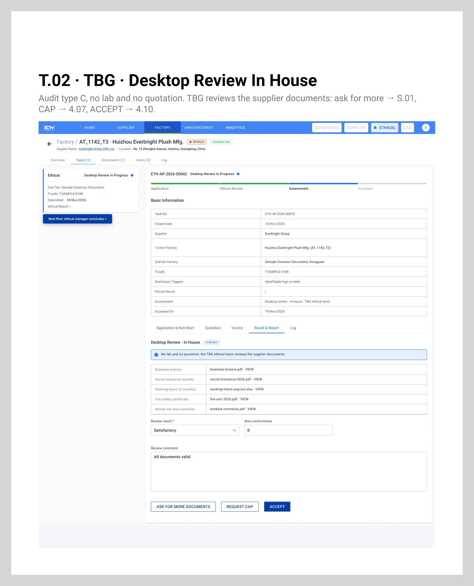

### 8 · Report and CAP

1. **Ethical team: [T.01 Review Lab Report](https://www.figma.com/design/HUpqECP1pJFN3GXZcMJgRH/TBG--Ethical---SQA?node-id=8343-14555).** Three outcomes:
   - accept the report;
   - request a revised report → **Lab:** [L.04](https://www.figma.com/design/HUpqECP1pJFN3GXZcMJgRH/TBG--Ethical---SQA?node-id=8343-13663);
   - NC found → [4.07 CAP Requested](https://www.figma.com/design/HUpqECP1pJFN3GXZcMJgRH/TBG--Ethical---SQA?node-id=8172-9524).
2. **Supplier: [4.08 Submit CAP](https://www.figma.com/design/HUpqECP1pJFN3GXZcMJgRH/TBG--Ethical---SQA?node-id=8172-9777).**
3. **Ethical team: [4.09 Review CAP](https://www.figma.com/design/HUpqECP1pJFN3GXZcMJgRH/TBG--Ethical---SQA?node-id=8172-10030).** Up to 3 rounds.

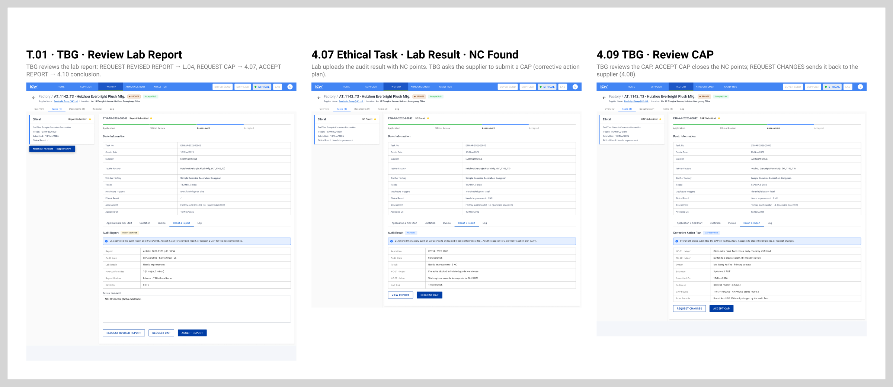
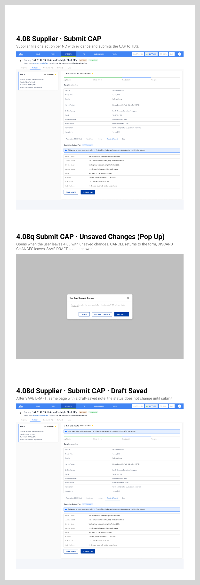
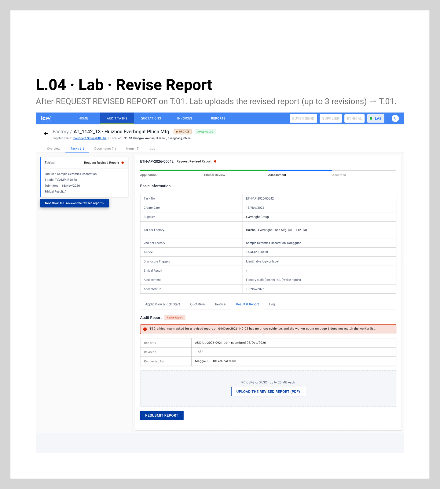

### 9 · Conclusion

- **Ethical manager: [4.10 Conclusion](https://www.figma.com/design/HUpqECP1pJFN3GXZcMJgRH/TBG--Ethical---SQA?node-id=8256-10993).** Four outcomes:
  - Approve: [4.11](https://www.figma.com/design/HUpqECP1pJFN3GXZcMJgRH/TBG--Ethical---SQA?node-id=8256-11625)
  - Approve · Conditional
  - [Temporary Approval (4.10t)](https://www.figma.com/design/HUpqECP1pJFN3GXZcMJgRH/TBG--Ethical---SQA?node-id=8256-11309)
  - [Rejected (4.11r)](https://www.figma.com/design/HUpqECP1pJFN3GXZcMJgRH/TBG--Ethical---SQA?node-id=8364-16696)
- **Buyer** sees the result on the Ethical Home dashboard.

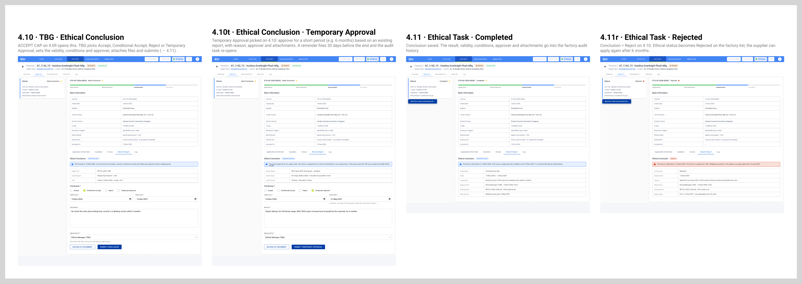

---

## Ethical status list (one column, in order)

| Stage | Status | Tone | Who acts next | Path | Screen |
| --- | --- | --- | --- | --- | --- |
| Application | Not Applied | Neutral | Supplier | ABCD | — |
| Application | Draft | Neutral | Supplier | ABCD | [1b.06d](https://www.figma.com/design/HUpqECP1pJFN3GXZcMJgRH/TBG--Ethical---SQA?node-id=8389-18812) |
| Application | Pending Review (Submitted) | Warning | Ethical team | ABCD | [E.03](https://www.figma.com/design/HUpqECP1pJFN3GXZcMJgRH/TBG--Ethical---SQA?node-id=8334-14734) / [1b.06](https://www.figma.com/design/HUpqECP1pJFN3GXZcMJgRH/TBG--Ethical---SQA?node-id=7979-2918) |
| Application | Waiting For Supplier Resubmit (Returned) | Warning | Supplier | ABCD | [E.04](https://www.figma.com/design/HUpqECP1pJFN3GXZcMJgRH/TBG--Ethical---SQA?node-id=8371-18403) / [1b.08](https://www.figma.com/design/HUpqECP1pJFN3GXZcMJgRH/TBG--Ethical---SQA?node-id=8382-13945) |
| Application | Resubmitted · Pending Review | Warning | Ethical team | ABCD | [E.03b](https://www.figma.com/design/HUpqECP1pJFN3GXZcMJgRH/TBG--Ethical---SQA?node-id=8374-13858) / [1b.08b](https://www.figma.com/design/HUpqECP1pJFN3GXZcMJgRH/TBG--Ethical---SQA?node-id=8382-14820) |
| Application | Application · Rejected (closed) | Error | — (the supplier starts a new application) | ABCD | [E.06](https://www.figma.com/design/HUpqECP1pJFN3GXZcMJgRH/TBG--Ethical---SQA?node-id=8366-18181) / [1b.08r](https://www.figma.com/design/HUpqECP1pJFN3GXZcMJgRH/TBG--Ethical---SQA?node-id=8382-15406) |
| Kick start | Wait For Kick Start (Accepted) | Neutral | Ethical team | ABCD | [4.02a](https://www.figma.com/design/HUpqECP1pJFN3GXZcMJgRH/TBG--Ethical---SQA?node-id=8366-17971) / [1b.08a](https://www.figma.com/design/HUpqECP1pJFN3GXZcMJgRH/TBG--Ethical---SQA?node-id=8382-15701) |
| Quotation | Waiting For Lab Quote | Info | Lab | AB | [4.04](https://www.figma.com/design/HUpqECP1pJFN3GXZcMJgRH/TBG--Ethical---SQA?node-id=8060-13986) |
| Quotation | TBG Reviewing Quote | Warning | Ethical team | AB | [4.04b](https://www.figma.com/design/HUpqECP1pJFN3GXZcMJgRH/TBG--Ethical---SQA?node-id=8169-10112) |
| Quotation | Waiting For Supplier Accept | Warning | Supplier | AB | [4.05](https://www.figma.com/design/HUpqECP1pJFN3GXZcMJgRH/TBG--Ethical---SQA?node-id=8068-6965) |
| Quotation | Quotation Rejected | Error | Ethical team | AB | [4.05x](https://www.figma.com/design/HUpqECP1pJFN3GXZcMJgRH/TBG--Ethical---SQA?node-id=8255-10875) |
| Invoice | Pending Invoice (invoice Draft) | Neutral | ICW account | AB | [4.12](https://www.figma.com/design/HUpqECP1pJFN3GXZcMJgRH/TBG--Ethical---SQA?node-id=8264-11556) |
| Invoice | Pending Payment (invoice Unpaid) | Warning | Supplier | AB | [4.13](https://www.figma.com/design/HUpqECP1pJFN3GXZcMJgRH/TBG--Ethical---SQA?node-id=8264-11826) |
| Audit | Pending Audit (invoice Paid) | Info | Lab | AB | [4.14](https://www.figma.com/design/HUpqECP1pJFN3GXZcMJgRH/TBG--Ethical---SQA?node-id=8264-12092) / [4.15](https://www.figma.com/design/HUpqECP1pJFN3GXZcMJgRH/TBG--Ethical---SQA?node-id=8264-12347) |
| Audit | Audit In Progress | Info | Lab | A | [L.03](https://www.figma.com/design/HUpqECP1pJFN3GXZcMJgRH/TBG--Ethical---SQA?node-id=8343-13077) |
| Audit | Pending Supplier Documents | Warning | Supplier | BCD | [S.01](https://www.figma.com/design/HUpqECP1pJFN3GXZcMJgRH/TBG--Ethical---SQA?node-id=8343-13944) |
| Audit | Desktop Review In Progress | Info | Lab / Ethical team | BC | [L.03b](https://www.figma.com/design/HUpqECP1pJFN3GXZcMJgRH/TBG--Ethical---SQA?node-id=8343-13370) / [T.02](https://www.figma.com/design/HUpqECP1pJFN3GXZcMJgRH/TBG--Ethical---SQA?node-id=8343-14858) |
| Report & CAP | Report Submitted | Warning | Ethical team | ABC | [T.01](https://www.figma.com/design/HUpqECP1pJFN3GXZcMJgRH/TBG--Ethical---SQA?node-id=8343-14555) |
| Report & CAP | Request Revised Report | Error | Lab | AB | [L.04](https://www.figma.com/design/HUpqECP1pJFN3GXZcMJgRH/TBG--Ethical---SQA?node-id=8343-13663) |
| Report & CAP | CAP Requested | Error | Supplier | ABCD | [4.07](https://www.figma.com/design/HUpqECP1pJFN3GXZcMJgRH/TBG--Ethical---SQA?node-id=8172-9524) / [4.08](https://www.figma.com/design/HUpqECP1pJFN3GXZcMJgRH/TBG--Ethical---SQA?node-id=8172-9777) |
| Report & CAP | CAP Submitted | Warning | Ethical team | ABCD | [4.09](https://www.figma.com/design/HUpqECP1pJFN3GXZcMJgRH/TBG--Ethical---SQA?node-id=8172-10030) |
| Conclusion | Need Conclusion | Warning | Ethical manager | ABCD | [4.10](https://www.figma.com/design/HUpqECP1pJFN3GXZcMJgRH/TBG--Ethical---SQA?node-id=8256-10993) |
| Conclusion | Approve | Success | — (valid until a date) | ABCD | [4.11](https://www.figma.com/design/HUpqECP1pJFN3GXZcMJgRH/TBG--Ethical---SQA?node-id=8256-11625) |
| Conclusion | Approve · Conditional | Success | Supplier (CAP follow-up) | ABCD | [4.11](https://www.figma.com/design/HUpqECP1pJFN3GXZcMJgRH/TBG--Ethical---SQA?node-id=8256-11625) |
| Conclusion | Temporary Approval | Warning | — (valid until a date) | ABCD | [4.10t](https://www.figma.com/design/HUpqECP1pJFN3GXZcMJgRH/TBG--Ethical---SQA?node-id=8256-11309) |
| Conclusion | Rejected | Error | — | ABCD | [4.11r](https://www.figma.com/design/HUpqECP1pJFN3GXZcMJgRH/TBG--Ethical---SQA?node-id=8364-16696) |

Naming rules: use **Approve**, not "Active". Use **Rejected**, not "Inactive". There is no "Expires" status; the validity date is shown instead.

---

## Supplier status list (what the supplier sees)

The supplier gets its own status names. Warning (amber) means it is the supplier's turn; Info (blue) means the supplier is waiting. On [1b.01 Factory List](https://www.figma.com/design/HUpqECP1pJFN3GXZcMJgRH/TBG--Ethical---SQA?node-id=7965-6602) each factory row shows the Ethical Task Status; clicking the status opens that task page, not the factory overview. The [map view (1b.01m)](https://www.figma.com/design/HUpqECP1pJFN3GXZcMJgRH/TBG--Ethical---SQA?node-id=8205-9607) colours each pin the same way; hovering a pin shows a tooltip ([1b.01mh](https://www.figma.com/design/HUpqECP1pJFN3GXZcMJgRH/TBG--Ethical---SQA?node-id=8435-16933)) and clicking it opens the task. The first status is **Need to Fill Application**: FILL APPLICATION on 1b.09n opens the form (1b.04).

| # | Supplier sees | Tone | Ethical team status | Supplier task page |
| --- | --- | --- | --- | --- |
| 1 | Need to Fill Application | Warning | Not Applied (application requested) | [1b.09n](https://www.figma.com/design/HUpqECP1pJFN3GXZcMJgRH/TBG--Ethical---SQA?node-id=8427-15696) |
| 2 | Draft | Warning | Draft | [1b.06d](https://www.figma.com/design/HUpqECP1pJFN3GXZcMJgRH/TBG--Ethical---SQA?node-id=8389-18812) |
| 3 | Pending Review | Info | Pending Review | [1b.06](https://www.figma.com/design/HUpqECP1pJFN3GXZcMJgRH/TBG--Ethical---SQA?node-id=7979-2918) |
| 4 | Application Returned | Warning | Waiting For Supplier Resubmit | [1b.08](https://www.figma.com/design/HUpqECP1pJFN3GXZcMJgRH/TBG--Ethical---SQA?node-id=8382-13945) |
| 5 | Resubmitted · Pending Review | Info | Resubmitted · Pending Review | [1b.08b](https://www.figma.com/design/HUpqECP1pJFN3GXZcMJgRH/TBG--Ethical---SQA?node-id=8382-14820) |
| 6 | Application Rejected | Error | Application · Rejected | [1b.08r](https://www.figma.com/design/HUpqECP1pJFN3GXZcMJgRH/TBG--Ethical---SQA?node-id=8382-15406) |
| 7 | Application Accepted | Success | Wait For Kick Start · Waiting For Lab Quote · TBG Reviewing Quote | [1b.08a](https://www.figma.com/design/HUpqECP1pJFN3GXZcMJgRH/TBG--Ethical---SQA?node-id=8382-15701) |
| 8 | Pending Quotation Accept | Warning | Waiting For Supplier Accept | [4.05](https://www.figma.com/design/HUpqECP1pJFN3GXZcMJgRH/TBG--Ethical---SQA?node-id=8068-6965) |
| 9 | Quotation Rejected | Error | Quotation Rejected | [4.05x](https://www.figma.com/design/HUpqECP1pJFN3GXZcMJgRH/TBG--Ethical---SQA?node-id=8255-10875) |
| 10 | Pending Invoice | Info | Pending Invoice | [1b.09i](https://www.figma.com/design/HUpqECP1pJFN3GXZcMJgRH/TBG--Ethical---SQA?node-id=8427-15968) |
| 11 | Pending Payment | Warning | Pending Payment | [4.13](https://www.figma.com/design/HUpqECP1pJFN3GXZcMJgRH/TBG--Ethical---SQA?node-id=8264-11826) |
| 12 | Pending Audit | Info | Pending Audit | [4.14](https://www.figma.com/design/HUpqECP1pJFN3GXZcMJgRH/TBG--Ethical---SQA?node-id=8264-12092) |
| 13 | Audit In Progress | Info | Audit In Progress | [1b.09u](https://www.figma.com/design/HUpqECP1pJFN3GXZcMJgRH/TBG--Ethical---SQA?node-id=8427-16240) |
| 14 | Pending Upload Documents | Warning | Pending Supplier Documents | [S.01](https://www.figma.com/design/HUpqECP1pJFN3GXZcMJgRH/TBG--Ethical---SQA?node-id=8343-13944) |
| 15 | Desktop Review In Progress | Info | Desktop Review In Progress | [S.02](https://www.figma.com/design/HUpqECP1pJFN3GXZcMJgRH/TBG--Ethical---SQA?node-id=8343-14270) |
| 16 | Report Under Review | Info | Report Submitted · Request Revised Report | [1b.09v](https://www.figma.com/design/HUpqECP1pJFN3GXZcMJgRH/TBG--Ethical---SQA?node-id=8427-16512) |
| 17 | CAP Required | Warning | CAP Requested | [4.08](https://www.figma.com/design/HUpqECP1pJFN3GXZcMJgRH/TBG--Ethical---SQA?node-id=8172-9777) |
| 18 | CAP Under Review | Info | CAP Submitted | [1b.09c](https://www.figma.com/design/HUpqECP1pJFN3GXZcMJgRH/TBG--Ethical---SQA?node-id=8427-16784) |
| 19 | Pending Result | Info | Need Conclusion | [1b.09p](https://www.figma.com/design/HUpqECP1pJFN3GXZcMJgRH/TBG--Ethical---SQA?node-id=8427-17056) |
| 20 | Approved | Success | Approve | [1b.09a](https://www.figma.com/design/HUpqECP1pJFN3GXZcMJgRH/TBG--Ethical---SQA?node-id=8427-17328) |
| 21 | Approved · Conditional | Success | Approve · Conditional | [1b.09k](https://www.figma.com/design/HUpqECP1pJFN3GXZcMJgRH/TBG--Ethical---SQA?node-id=8427-17588) |
| 22 | Temporary Approval | Warning | Temporary Approval | [1b.09t](https://www.figma.com/design/HUpqECP1pJFN3GXZcMJgRH/TBG--Ethical---SQA?node-id=8427-17857) |
| 23 | Rejected | Error | Rejected | [1b.09r](https://www.figma.com/design/HUpqECP1pJFN3GXZcMJgRH/TBG--Ethical---SQA?node-id=8427-18130) |

---

## Hand-off rules (impact areas)

1. **Every decision reason is typed in a required field.** This covers return, reject, resubmit, revised report and CAP. The reason is shown on two pages: the deciding role's page (status, by whom, when, reason, who was notified) and the receiving role's page (reason, next step, action button).
2. **The return loop repeats.** Read the reason → edit (answers kept, flagged section marked) → resubmit with a reason → wait, read only → return again (newest reason first, earlier rounds still listed), reject or accept.
3. **Actions that are not allowed are hidden.** There is no KICK START while an application is returned or rejected, and no EDIT while it is in review.
4. **Save draft.** Leaving any form with unsaved changes opens **You Have Unsaved Changes** (CANCEL / DISCARD CHANGES / SAVE DRAFT), using the SVSI pattern. After SAVE DRAFT, the page shows the draft:
   - [1b.06d](https://www.figma.com/design/HUpqECP1pJFN3GXZcMJgRH/TBG--Ethical---SQA?node-id=8389-18812): supplier application draft;
   - [1b.08d](https://www.figma.com/design/HUpqECP1pJFN3GXZcMJgRH/TBG--Ethical---SQA?node-id=8389-19189): returned application with a saved draft;
   - [E.03d](https://www.figma.com/design/HUpqECP1pJFN3GXZcMJgRH/TBG--Ethical---SQA?node-id=8389-19706): saved review draft;
   - [3.01b](https://www.figma.com/design/HUpqECP1pJFN3GXZcMJgRH/TBG--Ethical---SQA?node-id=8389-19534): template draft;
   - [S.01d](https://www.figma.com/design/HUpqECP1pJFN3GXZcMJgRH/TBG--Ethical---SQA?node-id=8394-19442), [4.08d](https://www.figma.com/design/HUpqECP1pJFN3GXZcMJgRH/TBG--Ethical---SQA?node-id=8394-19744), [L.03d](https://www.figma.com/design/HUpqECP1pJFN3GXZcMJgRH/TBG--Ethical---SQA?node-id=8394-20046): draft-saved pages for documents, CAP and the lab report.

   Pop-ups: [1b.04q](https://www.figma.com/design/HUpqECP1pJFN3GXZcMJgRH/TBG--Ethical---SQA?node-id=8389-18742) · [1b.08q](https://www.figma.com/design/HUpqECP1pJFN3GXZcMJgRH/TBG--Ethical---SQA?node-id=8389-19119) · [2.00q](https://www.figma.com/design/HUpqECP1pJFN3GXZcMJgRH/TBG--Ethical---SQA?node-id=8389-19464) · [3.03q](https://www.figma.com/design/HUpqECP1pJFN3GXZcMJgRH/TBG--Ethical---SQA?node-id=8389-19636) · [2.00q1](https://www.figma.com/design/HUpqECP1pJFN3GXZcMJgRH/TBG--Ethical---SQA?node-id=8394-19256) · [2.00bq](https://www.figma.com/design/HUpqECP1pJFN3GXZcMJgRH/TBG--Ethical---SQA?node-id=8394-19287) · [2.00tq](https://www.figma.com/design/HUpqECP1pJFN3GXZcMJgRH/TBG--Ethical---SQA?node-id=8394-19318) · [2.10aq](https://www.figma.com/design/HUpqECP1pJFN3GXZcMJgRH/TBG--Ethical---SQA?node-id=8394-19349) · [2.10bq](https://www.figma.com/design/HUpqECP1pJFN3GXZcMJgRH/TBG--Ethical---SQA?node-id=8394-19380) · [S.01q](https://www.figma.com/design/HUpqECP1pJFN3GXZcMJgRH/TBG--Ethical---SQA?node-id=8394-19411) · [4.08q](https://www.figma.com/design/HUpqECP1pJFN3GXZcMJgRH/TBG--Ethical---SQA?node-id=8394-19713) · [L.03q](https://www.figma.com/design/HUpqECP1pJFN3GXZcMJgRH/TBG--Ethical---SQA?node-id=8394-20015)
5. **Destructive actions are red.** REMOVE, DELETE DRAFT, REJECT and the trash icons all use the Danger colour.
6. **Every hand-off has a "Next flow" link** to the other role's page in the prototype.

---

## Gallery (img/)

| File | Shows |
| --- | --- |
| 00-page-overview.png | Whole Figma page: 5 role lanes × 9 stages |
| 01-ethical-home-lists.png | Ethical home, factory and supplier lists, review pages, templates |
| 02-buyer-send-application.png | Buyer sends the application e-mail |
| 03-supplier-application.png | Supplier factory list, profile, application form, pop-ups |
| 04-supplier-application-tab-reasons.png | Supplier Application tab: returned, edit, resubmitted, round 2, rejected, accepted, draft |
| 05-ethical-factory-check.png | Ethical factory review: accept, return, reject |
| 06-ethical-kick-start.png | Kick start |
| 07–09 | Quotation: lab, TBG markup, supplier accepts |
| 10–11 | Invoice: TBG draft, supplier unpaid / paid |
| 12–14 | Audit, supplier documents, in-house desktop review |
| 15–17 | Report review, CAP, revised report |
| 18-tbg-conclusion.png | Conclusion |
| 19-lab-audit-list.png | Lab audit list |
| 20-ethical-home-E00.png | Ethical home screen |
